# Replicated templates: visual catalog

43 templates are implemented in `src/templates/` (Remotion). Use one as a b-roll item:

```json
{"id":"hook","kind":"template","at":0.2,"duration":3,"template":"hooks-captions-caption-02",
 "texts":["Life is","shorter","than","your reality"],"colors":["#FFFFFF","#00FFD7","#FFFFFF","#F0FF00"],
 "x":0,"y":-500,"scale":0.8,"speed":1}
```

- `texts` / `colors` override the defaults below by index (omit to keep defaults). `x`,`y` are canvas px offsets, `scale` multiplies, `speed` retimes.
- Caption/Hook comps are 1080x1920 (portrait, text sits in the lower-middle of the frame by default: move with `y`). Premium comps are 1920x1080: they are fitted to the canvas width and centred, so they read small; use `scale` 1.3-1.8 and set `y`.
- Header treatment (keeps a template readable over footage): `bg` = illustration photo (pick a relevant one via find-assets / Pexels; frame the subject with `bgFocus`, e.g. "30% 45%"), `icon` = flat svg (top-right), `scrim` 0-1 + `scrimHeight` px + `solidHeight` px (fully opaque part, use it to hide a baked-in overlay before the long soft fade). Example: `"bg":"projects/x/assets/photos/a.jpg","icon":"projects/x/assets/icons/trend-up.svg","scrim":0.85,"scrimHeight":1100`.
- Graphics should paraphrase, not repeat, the captions: short label + one big word. Slots overflow if a word is too long (big line <= ~8 chars, yellow line <= ~10 chars in the Caption 01 / 02 layouts); use "" for unused lines.
- Template time starts at the item's `at`; the animation is mostly in the first 0.5-1.5 s, then it holds. Set `duration` to the beat length and cut with the speech.
- Each section: `look` = what it is, `motion` = how it enters, `use` = when to pick it, then the code defaults. Images are our own render (6 frames across the clip; premium ones are cropped to the text band).
- Quality: `ok` = layout and timing checked against the original preview; `approximate` = looks right in our render but glow, light-sweep, scatter or 3D were simplified, and the original was not compared frame by frame.
- Fonts are Google substitutes (Inter for NHaas Grotesk, Anton for Impact, Pacifico/Dancing Script for scripts, Michroma for Akira, Playfair Display for Playfair).

## Caption pack (portrait, 10 s, multi-line statement captions)

### `hooks-captions-caption-01` — Caption 01
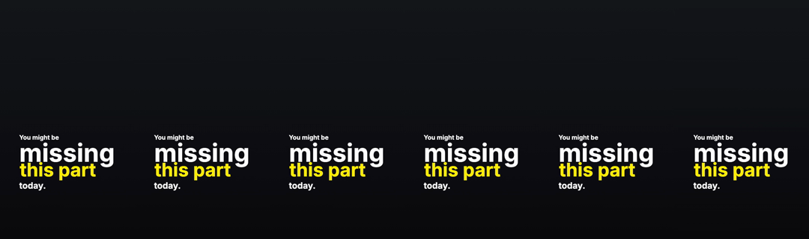
- look: Left-aligned stack: tiny white line, BIG white word, yellow line, small white closer.
- motion: words slide in from the right / rise from below while un-blurring; each word-group pops in: words start 1 frame apart, expo-out over ~8 frames, from an offset + blurred + transparent state; groups enter at 0 / ~0.12 / ~0.24 / ~0.5 s, then hold (no exit)
- use: calm hook or statement under a face; yellow carries the key phrase
- quality: ok
- defaults: texts ["You might be", "missing", "this part", "today."]; colours ["#FFFFFF", "#FFFFFF", "#FFED00", "#FFFFFF"]; fonts Inter; comp 1080x1920 @25fps, 10s
- original spec: `templates/hooks-captions-caption-01.md`

### `hooks-captions-caption-02` — Caption 02
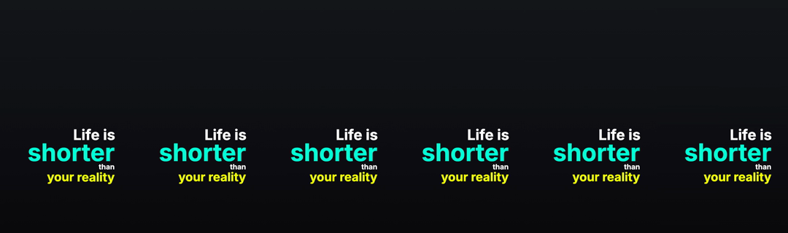
- look: Right-aligned stack: white line, HUGE cyan word, tiny connector, yellow closer.
- motion: each word-group pops in: words start 1 frame apart, expo-out over ~8 frames, from an offset + blurred + transparent state; groups enter at 0 / ~0.12 / ~0.24 / ~0.5 s, then hold (no exit)
- use: contrast statements ("X than Y"); key noun in cyan
- quality: ok
- defaults: texts ["Life is", "shorter", "than", "your reality"]; colours ["#FFFFFF", "#00FFD7", "#FFFFFF", "#F0FF00"]; fonts Inter; comp 1080x1920 @25fps, 10s
- original spec: `templates/hooks-captions-caption-02.md`

### `hooks-captions-caption-03` — Caption 03
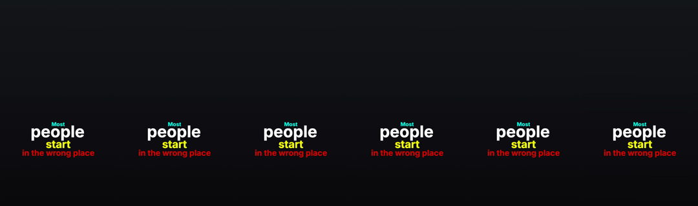
- look: Centred stack: tiny cyan lead-in, big white word, white verb, red closing phrase.
- motion: each word-group pops in: words start 1 frame apart, expo-out over ~8 frames, from an offset + blurred + transparent state; groups enter at 0 / ~0.12 / ~0.24 / ~0.5 s, then hold (no exit)
- use: warnings / mistakes ("most people start in the wrong place"); red = the problem
- quality: ok
- defaults: texts ["Most", "people", "start", "in the wrong place"]; colours ["#00FFE6", "#FFFFFF", "#F3FF00", "#D70000"]; fonts Inter; comp 1080x1920 @25fps, 10s
- original spec: `templates/hooks-captions-caption-03.md`

### `hooks-captions-caption-04` — Caption 04
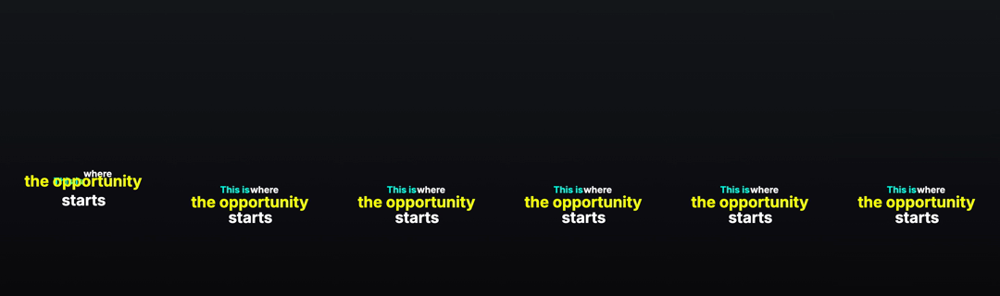
- look: Centred: tiny cyan + white lead-ins, yellow medium phrase, white closer.
- motion: each word-group pops in: words start 1 frame apart, expo-out over ~8 frames, from an offset + blurred + transparent state; groups enter at 0 / ~0.12 / ~0.24 / ~0.5 s, then hold (no exit); blur settles late
- use: short promise lines; yellow phrase is the payoff
- quality: ok
- defaults: texts ["This is", "where", "the opportunity", "starts"]; colours ["#00FFE6", "#FFFFFF", "#F3FF00", "#FFFFFF"]; fonts Inter; comp 1080x1920 @25fps, 10s
- original spec: `templates/hooks-captions-caption-04.md`

### `hooks-captions-caption-05` — Caption 05
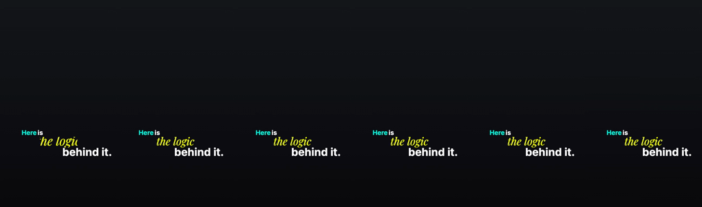
- look: Mixed type: cyan lead-in, yellow ITALIC SERIF phrase on the left, bold white closer on the right.
- motion: each word-group pops in: words start 1 frame apart, expo-out over ~8 frames, from an offset + blurred + transparent state; groups enter at 0 / ~0.12 / ~0.24 / ~0.5 s, then hold (no exit)
- use: editorial / insight lines; the serif words feel like a quote
- quality: ok
- defaults: texts ["Here", "is", "the logic", "behind it."]; colours ["#00FFE6", "#FFFFFF", "#F3FF00", "#FFFFFF"]; fonts Inter, Playfair Display; comp 1080x1920 @25fps, 10s
- original spec: `templates/hooks-captions-caption-05.md`

### `hooks-captions-caption-06` — Caption 06
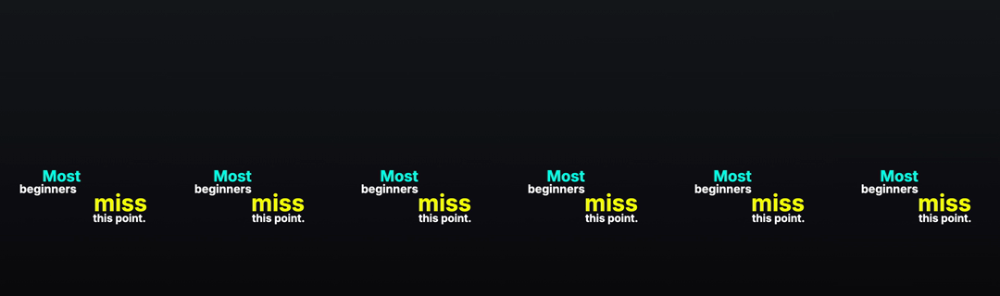
- look: Staggered diagonal: cyan big word top-left, white small word, yellow big word lower-right, small closer.
- motion: each word-group pops in: words start 1 frame apart, expo-out over ~8 frames, from an offset + blurred + transparent state; groups enter at 0 / ~0.12 / ~0.24 / ~0.5 s, then hold (no exit)
- use: two-beat contrast ("most beginners / miss this")
- quality: ok
- defaults: texts ["Most", "beginners", "miss", "this point."]; colours ["#00FFE6", "#FFFFFF", "#F3FF00", "#FFFFFF"]; fonts Inter; comp 1080x1920 @25fps, 10s
- original spec: `templates/hooks-captions-caption-06.md`

### `hooks-captions-caption-07` — Caption 07
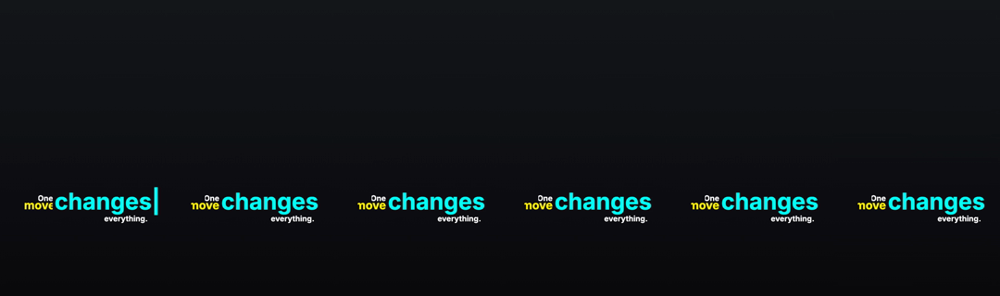
- look: Row of small yellow/white lead-in + HUGE cyan word with a blinking caret bar, small closer under it.
- motion: each word-group pops in: words start 1 frame apart, expo-out over ~8 frames, from an offset + blurred + transparent state; groups enter at 0 / ~0.12 / ~0.24 / ~0.5 s, then hold (no exit); caret blinks after reveal
- use: punchline lines ("one move changes everything")
- quality: ok
- defaults: texts ["One", "move", "changes", "everything."]; colours ["#FFFFFF", "#FFF100", "#00FFF6", "#FFFFFF"]; fonts Inter; comp 1080x1920 @25fps, 10s
- original spec: `templates/hooks-captions-caption-07.md`

### `hooks-captions-caption-08` — Caption 08
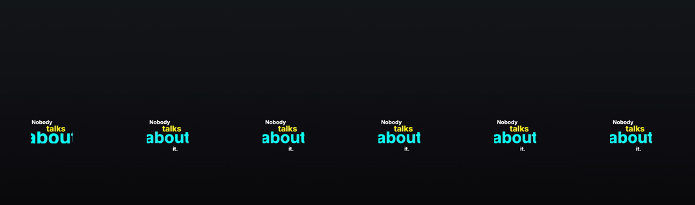
- look: Left stack: white lead-in, yellow word, HUGE cyan word, tiny closer.
- motion: each word-group pops in: words start 1 frame apart, expo-out over ~8 frames, from an offset + blurred + transparent state; groups enter at 0 / ~0.12 / ~0.24 / ~0.5 s, then hold (no exit)
- use: short punchy lines ("nobody talks about it")
- quality: ok
- defaults: texts ["Nobody", "talks", "about", "it."]; colours ["#FFFFFF", "#FFF100", "#00FFF6", "#FFFFFF"]; fonts Inter; comp 1080x1920 @25fps, 10s
- original spec: `templates/hooks-captions-caption-08.md`

### `hooks-captions-caption-09` — Caption 09
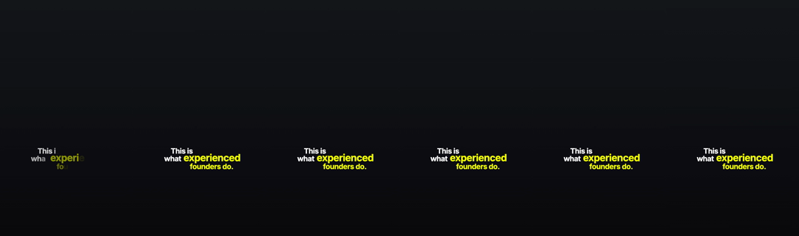
- look: Left two-line sentence: white lead words, yellow phrase on the second line.
- motion: each word-group pops in: words start 1 frame apart, expo-out over ~8 frames, from an offset + blurred + transparent state; groups enter at 0 / ~0.12 / ~0.24 / ~0.5 s, then hold (no exit); strong blur on entry
- use: sentence-style caption, medium size
- quality: ok
- defaults: texts ["This is", "what", "experienced", "founders do."]; colours ["#FFFFFF", "#FFFFFF", "#F3FF00", "#F3FF00"]; fonts Inter; comp 1080x1920 @25fps, 10s
- original spec: `templates/hooks-captions-caption-09.md`

### `hooks-captions-caption-10` — Caption 10
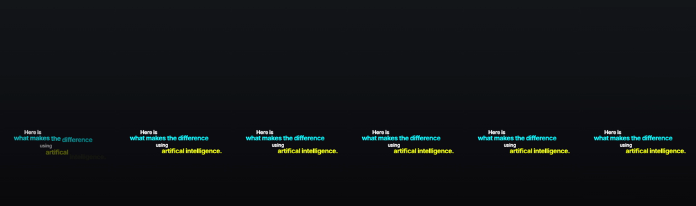
- look: Three-tier: cyan/white lead, white small connector, yellow phrase right-shifted.
- motion: each word-group pops in: words start 1 frame apart, expo-out over ~8 frames, from an offset + blurred + transparent state; groups enter at 0 / ~0.12 / ~0.24 / ~0.5 s, then hold (no exit)
- use: explanatory sentences with a highlighted noun phrase
- quality: ok
- defaults: texts ["Here is", "what makes the difference", "using", "artifical intelligence."]; colours ["#FFFFFF", "#00F9FF", "#FFFFFF", "#F3FF00"]; fonts Inter; comp 1080x1920 @25fps, 10s
- original spec: `templates/hooks-captions-caption-10.md`

### `hooks-captions-caption-11` — Caption 11
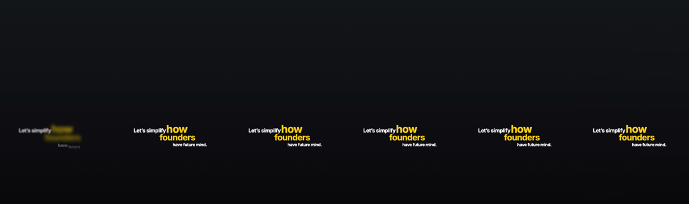
- look: Mixed: white lead-in, yellow bold word with a stacked white word, small grey tail line.
- motion: each word-group pops in: words start 1 frame apart, expo-out over ~8 frames, from an offset + blurred + transparent state; groups enter at 0 / ~0.12 / ~0.24 / ~0.5 s, then hold (no exit)
- use: list-like lines ("let's simplify how founders…")
- quality: ok
- defaults: texts ["Let’s simplify", "how", "founders", "have future mind."]; colours ["#FFFFFF", "#FFD100", "#FFD100", "#FFFFFF"]; fonts Inter; comp 1080x1920 @25fps, 10s
- original spec: `templates/hooks-captions-caption-11.md`

### `hooks-captions-caption-12` — Caption 12
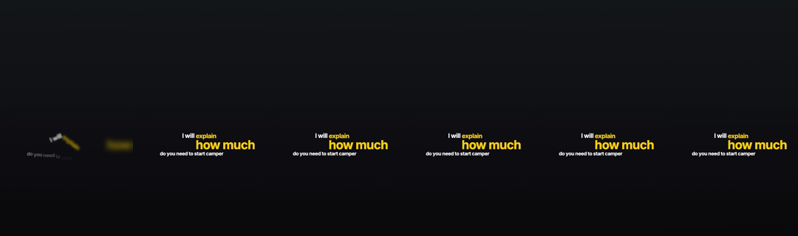
- look: White lead, yellow word, yellow bold phrase, small white tail.
- motion: each word-group pops in: words start 1 frame apart, expo-out over ~8 frames, from an offset + blurred + transparent state; groups enter at 0 / ~0.12 / ~0.24 / ~0.5 s, then hold (no exit); slide direction alternates
- use: explainer lines with a big yellow phrase
- quality: ok
- defaults: texts ["I will", "explain", "how much", "do you need to start camper"]; colours ["#FFFFFF", "#FFD100", "#FFD100", "#FFFFFF"]; fonts Inter; comp 1080x1920 @25fps, 10s
- original spec: `templates/hooks-captions-caption-12.md`

### `hooks-captions-caption-13` — Caption 13
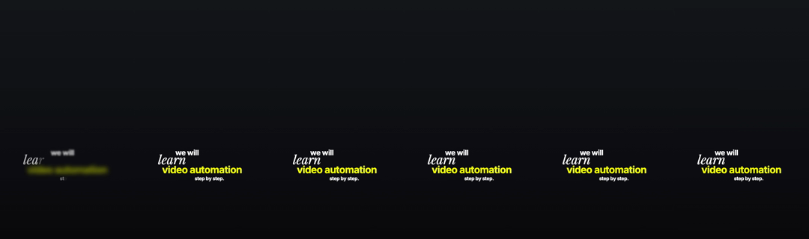
- look: White lead, ITALIC SERIF word, yellow phrase, small tail.
- motion: each word-group pops in: words start 1 frame apart, expo-out over ~8 frames, from an offset + blurred + transparent state; groups enter at 0 / ~0.12 / ~0.24 / ~0.5 s, then hold (no exit)
- use: tutorial / how-to lines
- quality: ok
- defaults: texts ["we will", "learn", "video automation", "step by step."]; colours ["#FFFFFF", "#FFFFFF", "#F3FF00", "#FFFFFF"]; fonts Inter, Playfair Display; comp 1080x1920 @25fps, 10s
- original spec: `templates/hooks-captions-caption-13.md`

### `hooks-captions-caption-14` — Caption 14
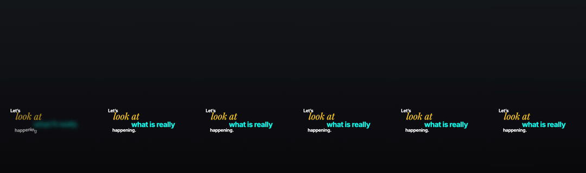
- look: Italic gold serif lead, cyan phrase, small white tail, tiny white opener.
- motion: each word-group pops in: words start 1 frame apart, expo-out over ~8 frames, from an offset + blurred + transparent state; groups enter at 0 / ~0.12 / ~0.24 / ~0.5 s, then hold (no exit)
- use: narrative lines; gold italic + cyan accent
- quality: ok
- defaults: texts ["Let’s", "look at", "what is really", "happening."]; colours ["#FFFFFF", "#FFC900", "#00FFEF", "#FFFFFF"]; fonts Inter, Playfair Display; comp 1080x1920 @25fps, 10s
- original spec: `templates/hooks-captions-caption-14.md`

### `hooks-captions-caption-15` — Caption 15
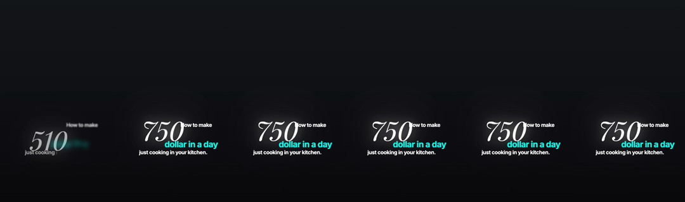
- look: Large white italic serif number/word with soft glow, white lead, cyan phrase, small tail.
- motion: each word-group pops in: words start 1 frame apart, expo-out over ~8 frames, from an offset + blurred + transparent state; groups enter at 0 / ~0.12 / ~0.24 / ~0.5 s, then hold (no exit); glow fades in
- use: numbers and money claims ("750 dollar in a day")
- quality: ok
- defaults: texts ["How to make", "750", "dollar in a day", "just cooking in your kitchen."]; colours ["#FFFFFF", "#FFFFFF", "#00FFEF", "#FFFFFF"]; fonts Inter, Playfair Display; comp 1080x1920 @25fps, 10s
- original spec: `templates/hooks-captions-caption-15.md`

## Hook pack (portrait, 5-6 s, opening hooks)

### `hooks-captions-hook-01` — Hook 01
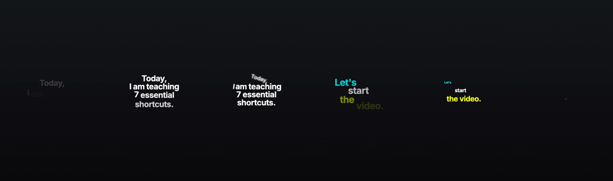
- look: Centred white multi-line block, bold sans, no accent colour until emphasis.
- motion: lines appear one after another with a slide + fade; ends ~5 s; later lines swap
- use: list / promise hook at the start ("today I am teaching 7 essential shortcuts")
- quality: ok
- defaults: texts ["Today,\nI am teaching\n7 essential\nshortcuts.", "Let's", "start", "the video."]; colours ["#FFFFFF", "#00F9FF", "#FFFFFF", "#F3FF00"]; fonts Inter; comp 1080x1920 @25fps, 5s
- original spec: `templates/hooks-captions-hook-01.md`

### `hooks-captions-hook-02` — Hook 02
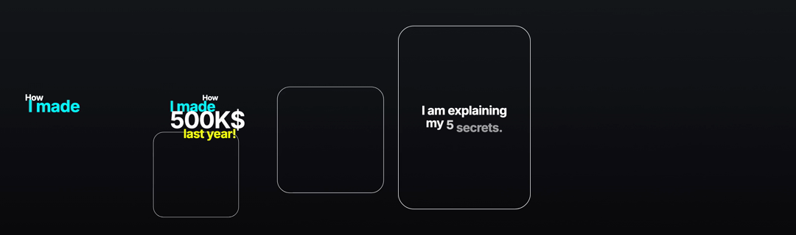
- look: Cyan + white + yellow lines with large "500K$"-style number; contains empty rounded media frames (image slots).
- motion: text pops; rounded frames scale in beside it
- use: needs footage in the frames: do not use without media
- quality: approximate: frames are empty placeholders
- defaults: texts ["How", "I made", "500K$", "last year!", "I am explaining\nmy 5 secrets."]; colours ["#FFFFFF", "#00F9FF", "#FFFFFF", "#F3FF00", "#FFFFFF"]; fonts Inter; comp 1080x1920 @25fps, 5s
- original spec: `templates/hooks-captions-hook-02.md`

### `hooks-captions-hook-03` — Hook 03
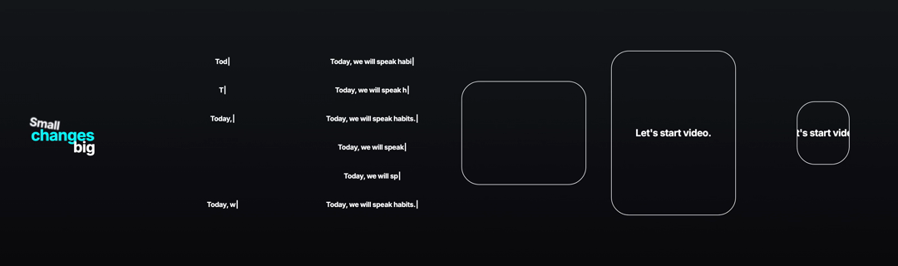
- look: Centred type-on lines with a caret in rounded frames; cyan accent words.
- motion: typewriter reveal with caret; frames fade in
- use: habit / step lists; empty frames
- quality: approximate: frames are empty placeholders
- defaults: texts ["Small", "changes", "big", "results", "Today, we will speak habits.", "Let's start video."]; colours ["#FFFFFF", "#00F9FF", "#FFFFFF", "#F3FF00", "#FFFFFF", "#FFFFFF"]; fonts Inter; comp 1080x1920 @25fps, 6s
- original spec: `templates/hooks-captions-hook-03.md`

### `hooks-captions-hook-04` — Hook 04
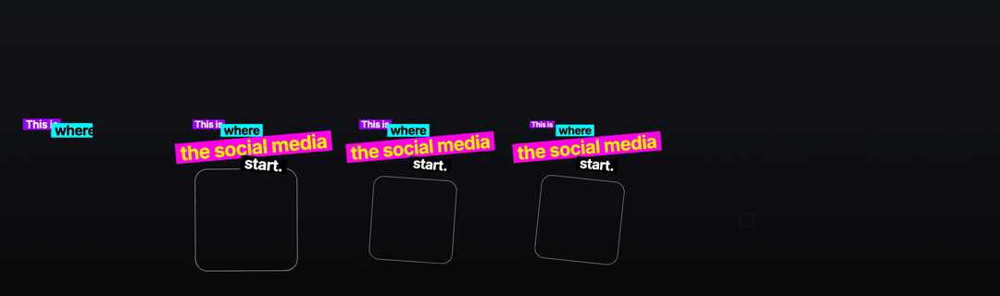
- look: Highlight-bar type: purple, cyan and magenta bars behind white/yellow words, a tilted rounded frame.
- motion: bars wipe in behind words; frame rotates slightly
- use: loud social-media hooks; empty tilted frame
- quality: approximate: frame is an empty placeholder
- defaults: texts ["This is", "where", "the social media", "start."]; colours ["#FFFFFF", "#9F00FF", "#000000", "#00F9FF", "#FFEC00", "#FF00E7", "#FFFFFF", "#000000"]; fonts Inter; comp 1080x1920 @25fps, 5s
- original spec: `templates/hooks-captions-hook-04.md`

### `hooks-captions-hook-05` — Hook 05
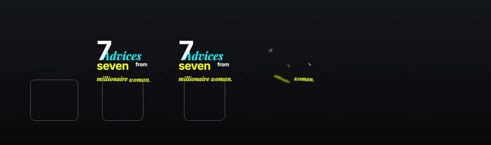
- look: Mixed serif/sans: huge white 7, cyan serif word, yellow sans word, yellow italic serif line, empty frames.
- motion: words swap with wipes; last line dissolves
- use: numbered "advice" hooks; empty frames
- quality: approximate: frames are empty placeholders
- defaults: texts ["7", "Advices", "from", "seven\nmillionaire woman."]; colours ["#FFFFFF", "#00F9FF", "#FFFFFF", "#F3FF00"]; fonts Inter, Playfair Display; comp 1080x1920 @25fps, 5s
- original spec: `templates/hooks-captions-hook-05.md`

## Premium text pack (landscape comps, 2-5 s, title / lyric cards)

### `premium-text-copy-of-addtext` — Add Text
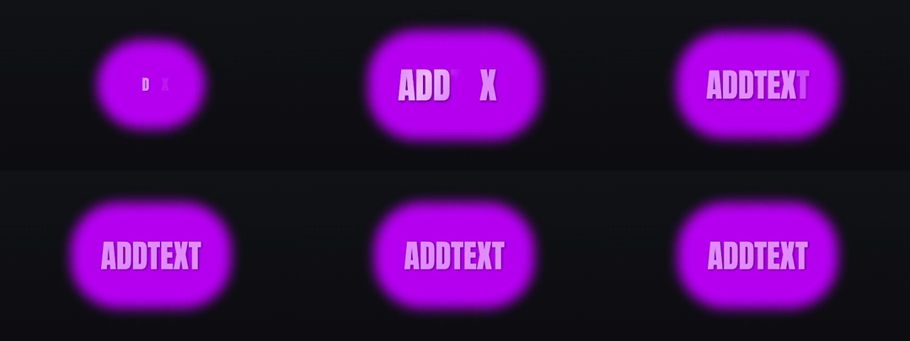
- look: Magenta blurred pill with white condensed ADDTEXT.
- motion: pill pops in, letters type on, soft blur-glow pulse
- use: label / tag over footage; short (2 s)
- quality: approximate
- defaults: texts ["ADDTEXT"]; colours ["#C000FF"]; fonts Anton; comp 1920x1080 @59.94fps, 2.269s
- original spec: `templates/premium-text-copy-of-addtext.md`

### `premium-text-copy-of-animations-jishan` — Animations (Jishan)
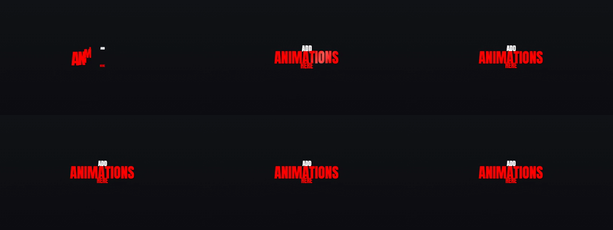
- look: Red condensed ANIMATIONS with tiny ADD / HERE lines, no glow.
- motion: letters scramble in then settle; fast
- use: bold keyword card; 3.5 s
- quality: approximate
- defaults: texts ["ADD", "ANIMATIONS", "HERE"]; colours ["#FFFFFF", "#FF0000", "#FF0000"]; fonts Anton; comp 1920x1080 @23.976fps, 3.462s
- original spec: `templates/premium-text-copy-of-animations-jishan.md`

### `premium-text-copy-of-insert` — Insert
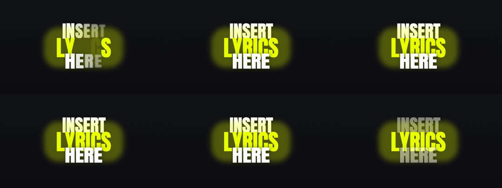
- look: Yellow-lit pill (glow) with white condensed INSERT / LYRICS / HERE stack.
- motion: letters flip in, yellow halo breathes
- use: highlighted lyric / keyword; 2.7 s
- quality: approximate
- defaults: texts ["INSERT", "LYRICS", "HERE"]; colours ["#FFFFFF", "#EBFF00", "#FFFFFF"]; fonts Anton; comp 1920x1080 @59.94fps, 2.719s
- original spec: `templates/premium-text-copy-of-insert.md`

### `premium-text-copy-of-lyrics-1` — Lyrics 1
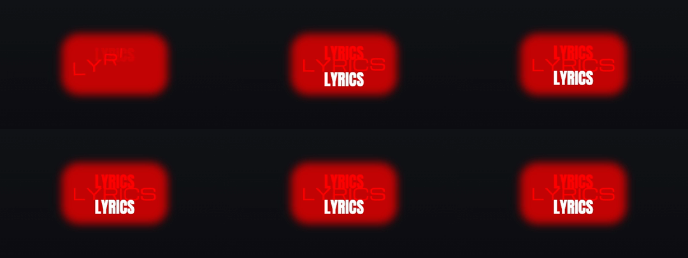
- look: Red glow pill, white small LYRICS with ghost red outline text.
- motion: ghosted letters collapse into a single line, red glow pulse
- use: lyric line card
- quality: approximate
- defaults: texts ["LYRICS", "LYRICS", "LYRICS"]; colours ["#FF0000", "#FF0000", "#FFFFFF"]; fonts Anton, Michroma; comp 1920x1080 @23.976fps, 2.336s
- original spec: `templates/premium-text-copy-of-lyrics-1.md`

### `premium-text-copy-of-lyrics-6` — Lyrics 6
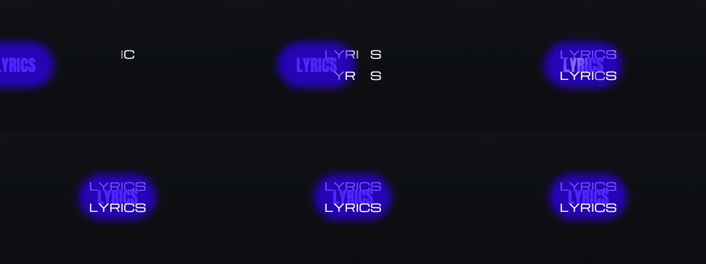
- look: Blue glow pill, wide light LYRICS (wide font) with repeated ghost lines.
- motion: ghost copies converge, blue glow
- use: cool-toned lyric card
- quality: approximate
- defaults: texts ["LYRICS", "LYRICS", "LYRICS"]; colours ["#FFFFFF", "#3400FF", "#FFFFFF"]; fonts Anton, Michroma; comp 1920x1080 @23.976fps, 2.419s
- original spec: `templates/premium-text-copy-of-lyrics-6.md`

### `premium-text-copy-of-lyrics-7` — Lyrics 7
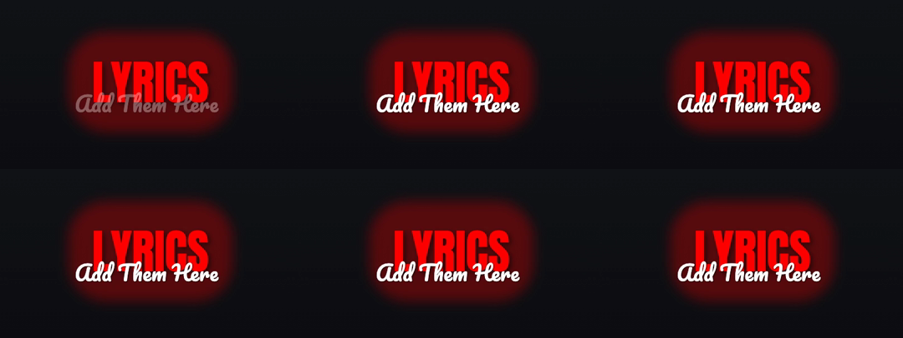
- look: Big red condensed LYRICS above white script "Add Them Here", red glow.
- motion: caps slam in, script writes on beneath
- use: lyric / title with a signature
- quality: approximate
- defaults: texts ["LYRICS", "Add Them Here"]; colours ["#FF0000", "#FFFFFF"]; fonts Anton, Pacifico; comp 1920x1080 @59.94fps, 2.719s
- original spec: `templates/premium-text-copy-of-lyrics-7.md`

### `premium-text-copy-of-lyrics-animation` — Lyrics Animation
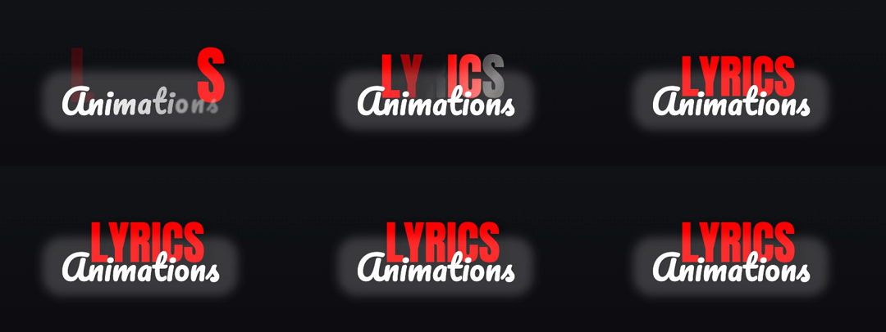
- look: Red condensed LYRICS above script "Animations" on a grey frosted pill.
- motion: letters drop in, pill fades up
- use: title with subtitle
- quality: approximate
- defaults: texts ["LYRICS", "Animations"]; colours ["#FF0000", "#FFFFFF"]; fonts Anton, Pacifico; comp 1920x1080 @23.976fps, 2.419s
- original spec: `templates/premium-text-copy-of-lyrics-animation.md`

### `premium-text-copy-of-lyrics-jishan` — Lyrics (Jishan)
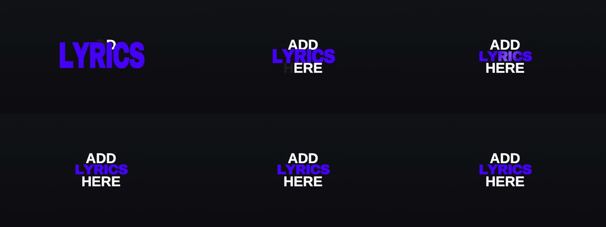
- look: Blue condensed LYRICS between white ADD / HERE lines.
- motion: letters grow in, blue tint
- use: clean three-line label
- quality: approximate
- defaults: texts ["add", "LYRICS", "HERE"]; colours ["#FFFFFF", "#4700FF", "#FFFFFF"]; fonts Arimo, Archivo Black; comp 1920x1080 @23.976fps, 3.462s
- original spec: `templates/premium-text-copy-of-lyrics-jishan.md`

### `premium-text-copy-of-place-11` — Place 11
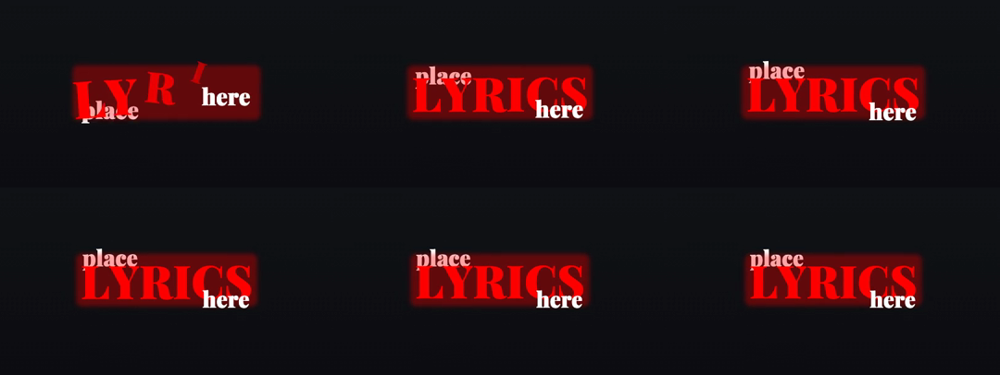
- look: Red serif LYRICS with tiny white place / here, red glow box.
- motion: serif caps slam in, soft red halo
- use: classic serif title card
- quality: approximate
- defaults: texts ["place", "LYRICS", "here"]; colours ["#FFFFFF", "#FF0000", "#FFFFFF"]; fonts Playfair Display; comp 1920x1080 @59.94fps, 3.554s
- original spec: `templates/premium-text-copy-of-place-11.md`

### `premium-text-copy-of-place-12` — Place 12
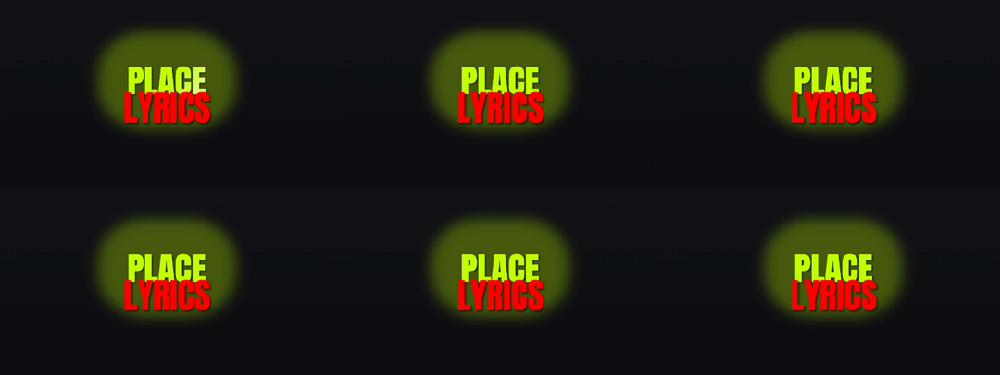
- look: Lime halo; white condensed PLACE over red LYRICS.
- motion: letters pop in with lime glow pulse
- use: high-energy gaming/tech title
- quality: approximate
- defaults: texts ["PLACE", "LYRICS"]; colours ["#C5FF00", "#FF0000"]; fonts Anton; comp 1920x1080 @59.94fps, 2.45s
- original spec: `templates/premium-text-copy-of-place-12.md`

### `premium-text-copy-of-put-lyrics` — Put Lyrics
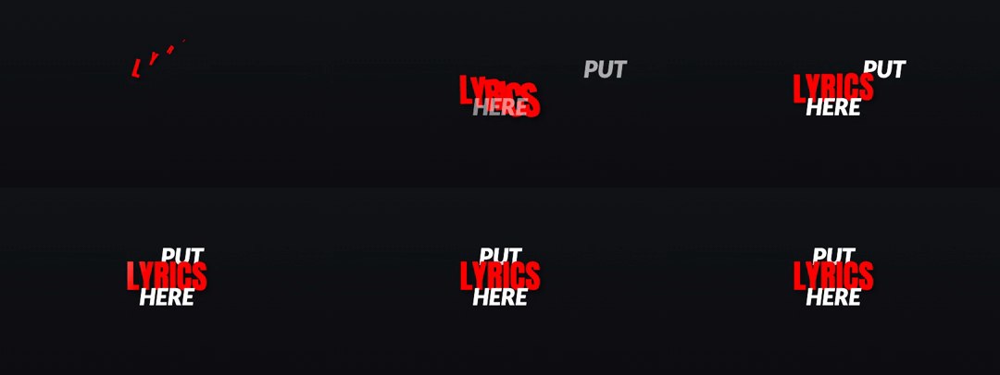
- look: Red condensed LYRICS with white PUT / HERE.
- motion: letters tear in, small word slides
- use: short lyric / punch title
- quality: approximate
- defaults: texts ["PUT", "LYRICS", "HERE"]; colours ["#FFFFFF", "#FF0000", "#FFFFFF"]; fonts Lato, Anton; comp 1920x1080 @23.976fps, 2.419s
- original spec: `templates/premium-text-copy-of-put-lyrics.md`

### `premium-text-copy-of-text-13` — Text 13
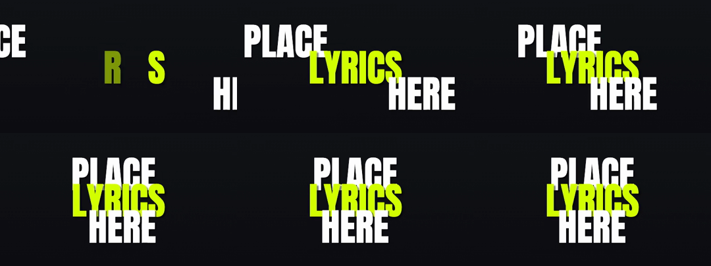
- look: Lime condensed PLACE / LYRICS with white HERE.
- motion: words slide in from the sides, overlapping
- use: bright title block (1920x1080 comp)
- quality: approximate
- defaults: texts ["PLACE", "LYRICS", "HERE"]; colours ["#FFFFFF", "#D3FF00", "#FFFFFF"]; fonts Anton; comp 1920x1080 @59.94fps, 2.269s
- original spec: `templates/premium-text-copy-of-text-13.md`

### `premium-text-copy-of-text-14` — TEXT 14
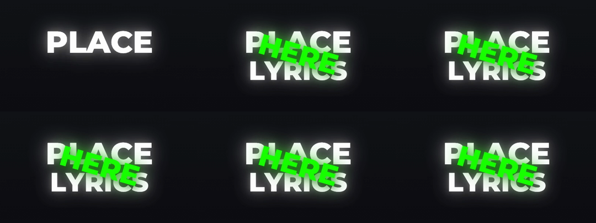
- look: White glowing PLACE with a tilted green HERE and LYRICS underneath.
- motion: PLACE fades in, HERE stamps on a tilt, glow pulse
- use: pop-title with a green sticker word
- quality: approximate
- defaults: texts ["PLACE", "LYRICS", "HERE"]; colours ["#FFFFFF", "#FFFFFF", "#18FF00"]; fonts Montserrat; comp 1920x1080 @59.94fps, 2.002s
- original spec: `templates/premium-text-copy-of-text-14.md`

### `premium-text-copy-of-text-15` — TEXT 15
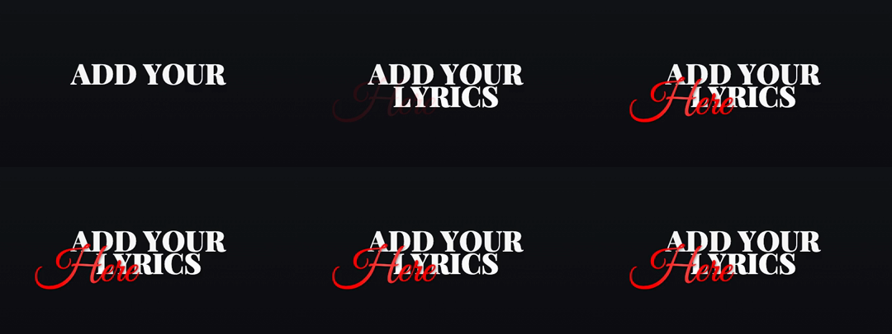
- look: White serif ADD YOUR, red script "Here" overlapping LYRICS (serif).
- motion: serif lines fade up, red script writes over
- use: elegant title with signature accent
- quality: approximate
- defaults: texts ["ADD YOUR", "LYRICS", "Here"]; colours ["#F7F7F7", "#FCFCFC", "#FF0000"]; fonts Playfair Display, Great Vibes; comp 1920x1080 @59.94fps, 3.52s
- original spec: `templates/premium-text-copy-of-text-15.md`

### `premium-text-copy-of-text-16` — TEXT 16
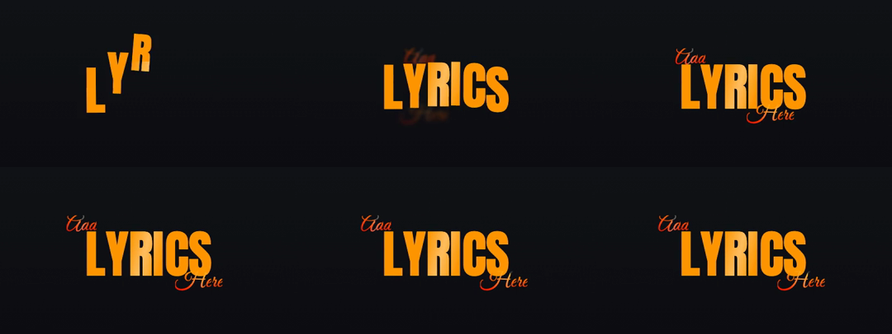
- look: Orange-to-yellow gradient condensed LYRICS with small script "Here".
- motion: letters rise in with warm glow, script fades
- use: warm cinematic title
- quality: approximate
- defaults: texts ["Add", "LYRICS", "Here"]; colours ["#FF7400", "#FF9600", "#FFB800"]; fonts Anton, Great Vibes; comp 1920x1080 @59.94fps, 2.002s
- original spec: `templates/premium-text-copy-of-text-16.md`

### `premium-text-copy-of-text-17` — TEXT 17
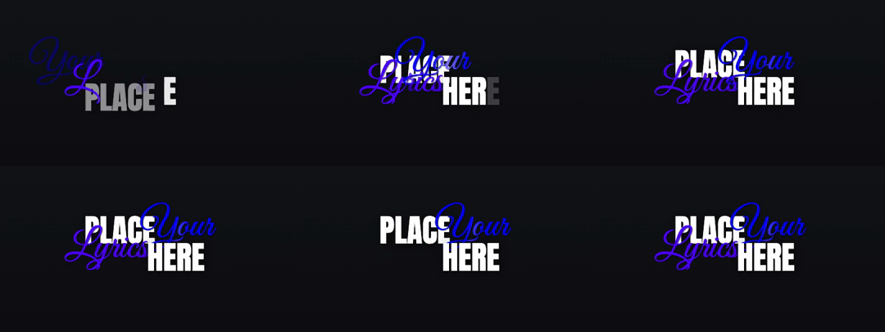
- look: White condensed PLACE / HERE around a blue script "Your Lyrics".
- motion: script writes over the stack
- use: title with a script flourish
- quality: approximate
- defaults: texts ["PLACE", "Your", "HERE", "Lyrics"]; colours ["#FFFFFF", "#0400FF", "#FFFFFF", "#4C00FF"]; fonts Anton, Great Vibes; comp 1920x1080 @59.94fps, 2.002s
- original spec: `templates/premium-text-copy-of-text-17.md`

### `premium-text-copy-of-text-19` — TEXT 19
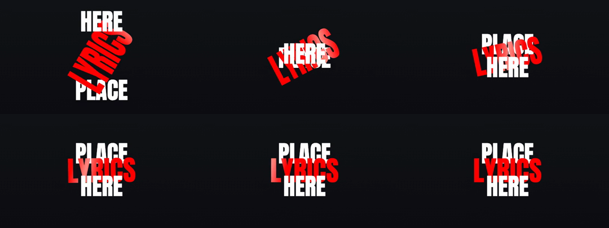
- look: White PLACE / HERE with a red tilted LYRICS slashed across.
- motion: red word swings in diagonally, stack settles
- use: aggressive keyword
- quality: approximate
- defaults: texts ["PLACE", "LYRICS", "HERE"]; colours ["#FFFFFF", "#FF0000", "#FFFFFF"]; fonts Anton; comp 1920x1080 @59.94fps, 2.002s
- original spec: `templates/premium-text-copy-of-text-19.md`

### `premium-text-copy-of-text-20` — TEXT 20
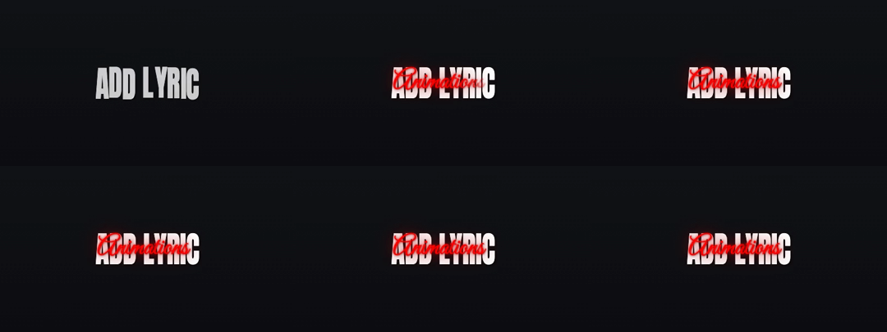
- look: Grey condensed ADD LYRIC with red script overlay.
- motion: letters shake in, script overlays in red
- use: glitchy lyric label
- quality: approximate
- defaults: texts ["ADD LYRIC", "Animations"]; colours ["#FFFFFF", "#FF0000"]; fonts Anton, Great Vibes; comp 1920x1080 @59.94fps, 2.002s
- original spec: `templates/premium-text-copy-of-text-20.md`

### `premium-text-copy-of-text-21` — TEXT 21
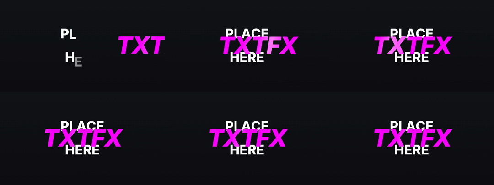
- look: Big magenta italic TXTFX with small white PLACE / HERE.
- motion: letters swing in, magenta stamp
- use: playful title
- quality: approximate
- defaults: texts ["plACE", "TXTFX", "here"]; colours ["#FFFFFF", "#F800FF", "#FFFFFF"]; fonts Inter; comp 1920x1080 @59.94fps, 2.019s
- original spec: `templates/premium-text-copy-of-text-21.md`

### `premium-text-copy-of-text-22` — TEXT 22
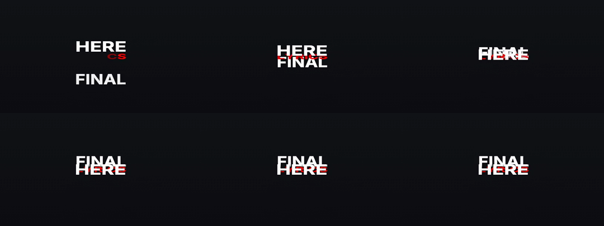
- look: White HERE / FINAL stack with a red strike line.
- motion: words slide and cross, strike wipes
- use: minimal keyword with strike-through
- quality: approximate
- defaults: texts ["FINAL", "LYRICS", "HERE"]; colours ["#FFFFFF", "#FF0000", "#FFFFFF"]; fonts Inter; comp 1920x1080 @59.94fps, 2.019s
- original spec: `templates/premium-text-copy-of-text-22.md`

### `premium-text-copy-of-text` — TEXT 18
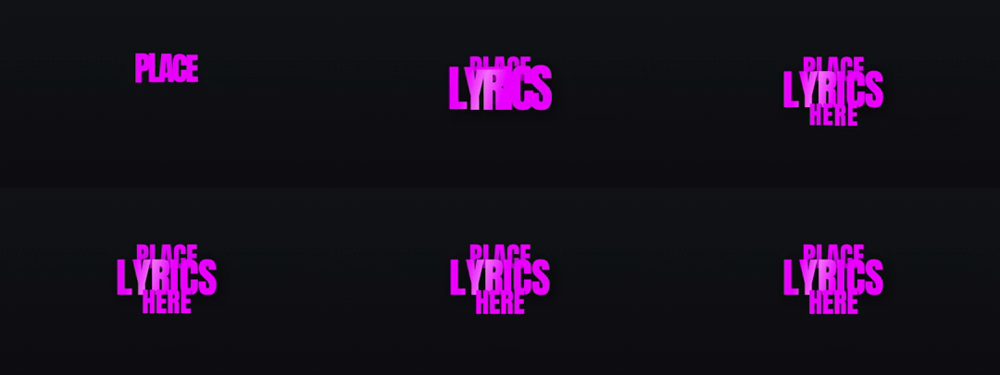
- look: Magenta condensed PLACE / LYRICS / HERE stack.
- motion: words stagger in, one overlaps the next
- use: neon-magenta title block
- quality: approximate
- defaults: texts ["PLACE", "LYRICS", "HERE"]; colours ["#EA00FF", "#EA00FF", "#EA00FF"]; fonts Anton; comp 1920x1080 @59.94fps, 2.002s
- original spec: `templates/premium-text-copy-of-text.md`

### `premium-text-copy-of-txtfx-8` — TXTFX 8
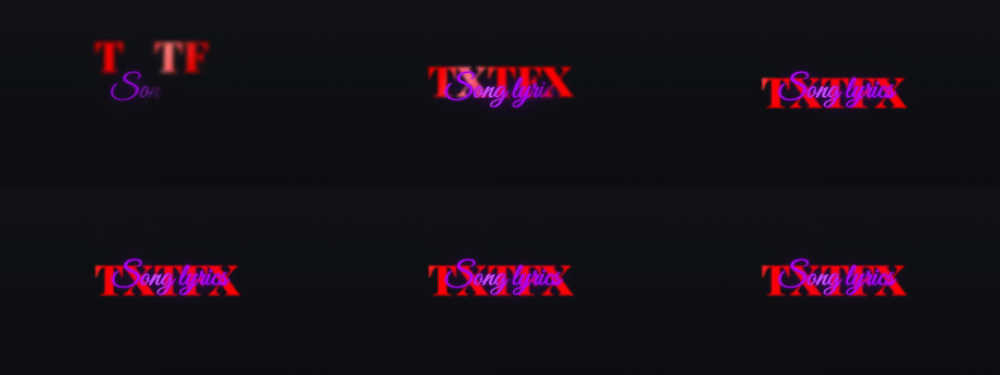
- look: Red serif TXTFX with purple script "Song lyrics" overlay, blur-glow.
- motion: serif caps blur in, purple script writes over
- use: dramatic serif title
- quality: approximate
- defaults: texts ["txtfx", "Song lyrics"]; colours ["#FF0000", "#AC00FF"]; fonts Playfair Display, Great Vibes; comp 1920x1080 @59.94fps, 2.069s
- original spec: `templates/premium-text-copy-of-txtfx-8.md`

### `premium-text-copy-of-untitled` — Untitled

- look: Identical to text-14.
- motion: see text-14
- use: alias
- quality: approximate
- defaults: texts ["PLACE", "LYRICS", "HERE"]; colours ["#FFFFFF", "#FFFFFF", "#18FF00"]; fonts Montserrat; comp 1920x1080 @59.94fps, 2.002s
- original spec: `templates/premium-text-copy-of-untitled.md`
